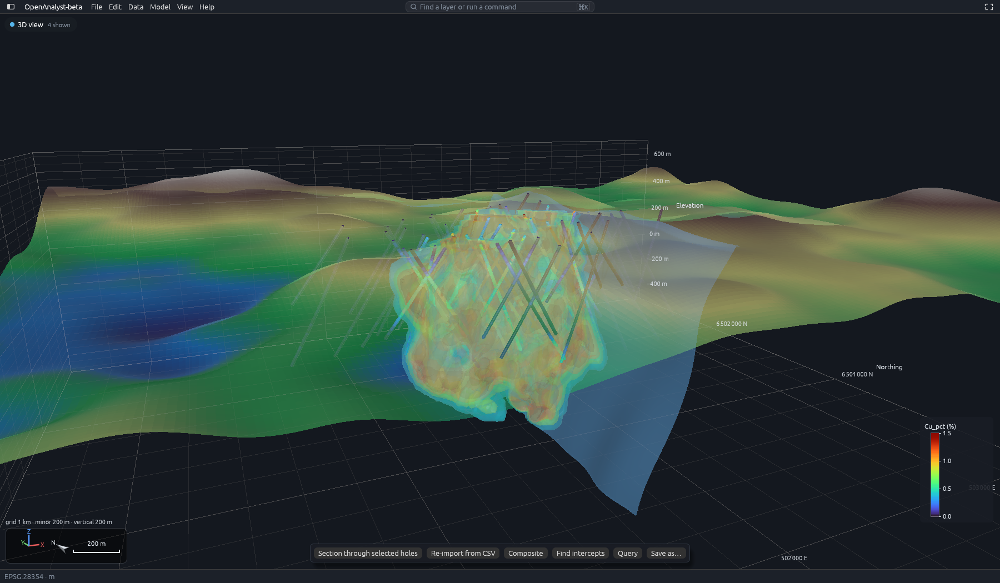
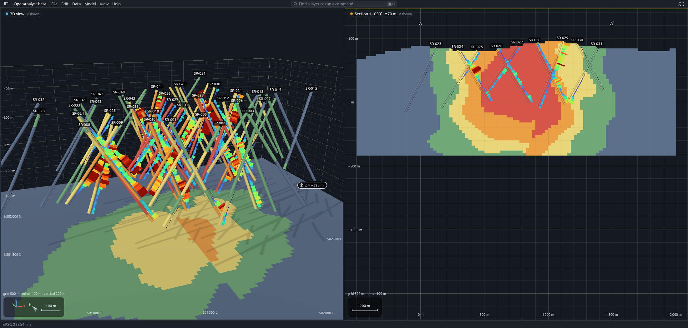
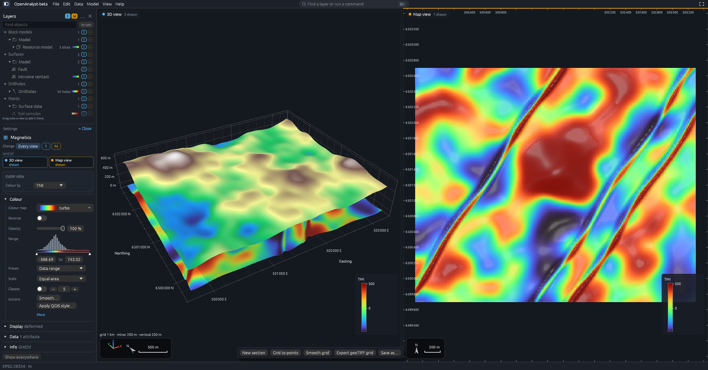
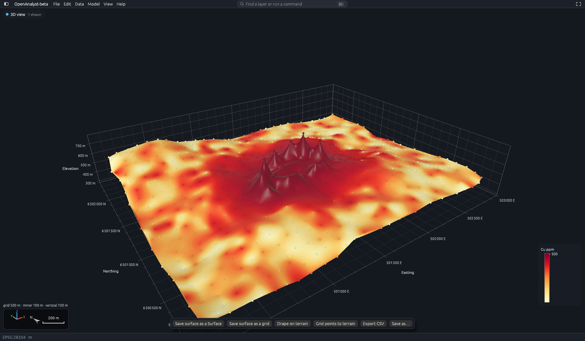
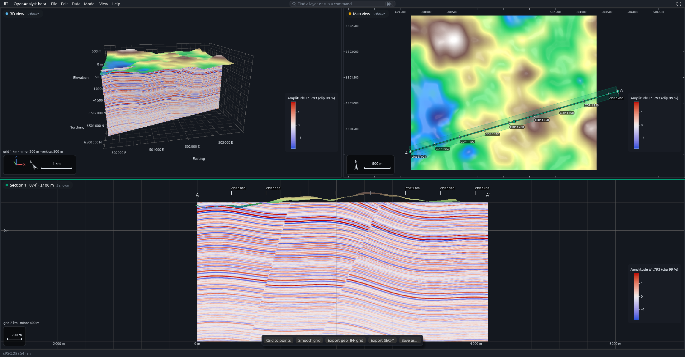
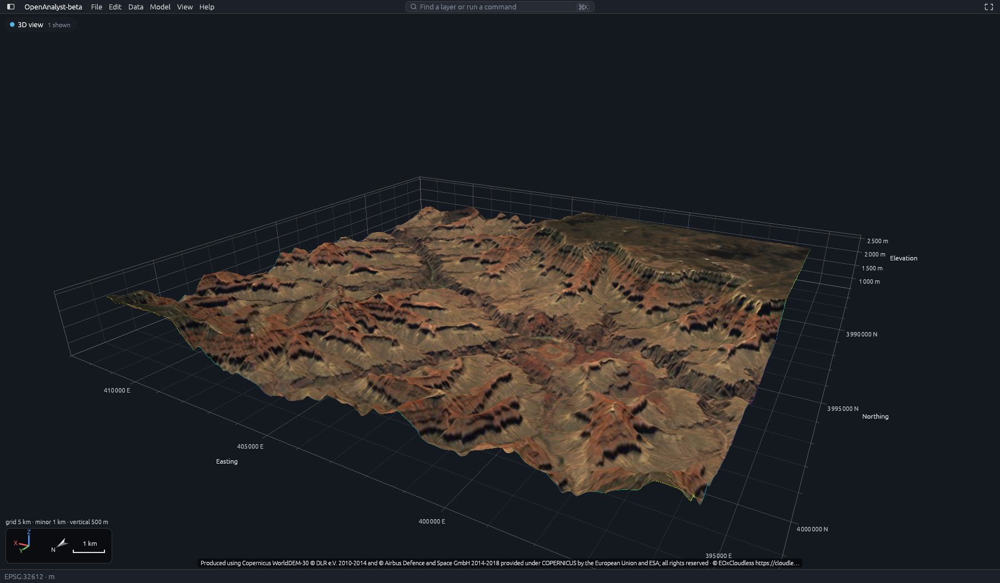

# OpenAnalyst-beta

A 3D viewer and analysis app for geoscience data. It reads and writes `.geoh5` projects and runs on macOS, Windows and Linux,
on Intel/AMD and ARM.

**[Download the latest version](https://github.com/nukolas/openanalyst-releases/releases/latest)** · Install on
[macOS](INSTALL-macOS.md), [Windows](INSTALL-Windows.md) or [Linux](INSTALL-Linux.md) · [Licence](LICENCE.txt)

*The pictures show made-up data, apart from the Grand Canyon.*

## What it does

### Drillholes, models and sections

- Drillholes from collar, survey and interval CSVs, with checks before the import: tubes coloured by any column, logs beside
  the hole, labels, filters, queries, composites and intercepts.
- Tensor and octree block models: slices you drag by their label, class shells, masks and thresholds.
- Sections drawn on a map: a live tile showing holes, models and surfaces along the line.

### Grids, surfaces and points

- Several linked 3D views, maps and sections at once. Each can show the same layer in its own way.
- Over 100 colour maps, histogram ranges, equal-area and log stretches, classes and categories.
- Grids lifted by their values, or by terrain; smoothing and upward continuation.
- Scattered points drawn as a surface: natural neighbour, inverse distance, triangles, Voronoi cells or hexagons.

### Seismic

- SEG-Y 2D lines and 3D volumes, with guesses you can check for the headers, and volumes larger than memory.
- Gain, clip, polarity and wiggles; inline, crossline and time slices; depth conversion by a velocity model.

### Maps, imagery and terrain from the web

- Terrain, satellite imagery, geological maps, magnetics, gravity, earthquakes and published 3D models from open sources, each
  shown with its licence and credit.
- Live geology maps you can click to ask what is there.
- Large georeferenced pictures, draped on terrain, sections and models.

### And

- **Uncertainty:** posterior draws of a model played as an animation, with averages, spreads, probabilities and their boundaries.
- **Lighting:** studio or torch light, shadows and fog, for reading shape.
- **Formats:** `.geoh5`, CSV, GeoTIFF, ASCII grids, shapefile, GeoPackage, GeoJSON, KML, DXF, OBJ, UBC meshes and models, GOCAD,
  SEG-Y, and QGIS projects with their styles. Many can be saved back out.
- **Coordinates:** data in another system is converted as it is imported; a whole project can be reprojected.
- **Agents:** an AI agent can drive the window you have open, if you allow it, and every change can be undone.
- **Private:** no account and no telemetry. It uses the internet for maps you ask for and to look for updates, which can be
  turned off.
- **Updates itself:** it looks for a newer signed version, downloads it, and restarts into it when you choose.

## It is a beta

Keep copies of projects you can't make again, and check results before relying on them. It isn't signed with an Apple or Microsoft
certificate, so the first open takes an extra step, described in the install pages. It needs a graphics driver with Metal, Vulkan or
DirectX 12.

**Problems and ideas:** open an [issue](https://github.com/nukolas/openanalyst-releases/issues). Don't attach confidential data.

This repository holds builds only, not the source ("Source code" on a release is only this page's files). Using the app means you
agree to its [licence](LICENCE.txt).

Terrain in the Grand Canyon picture: produced using Copernicus WorldDEM-30 © DLR e.V. 2010-2014 and © Airbus Defence and Space
GmbH 2014-2018, provided under COPERNICUS by the European Union and ESA; all rights reserved. Imagery:
[EOxCloudless](https://cloudless.eox.at) by EOX IT Services GmbH (contains modified Copernicus Sentinel data 2016),
[CC BY 4.0](https://creativecommons.org/licenses/by/4.0/).
